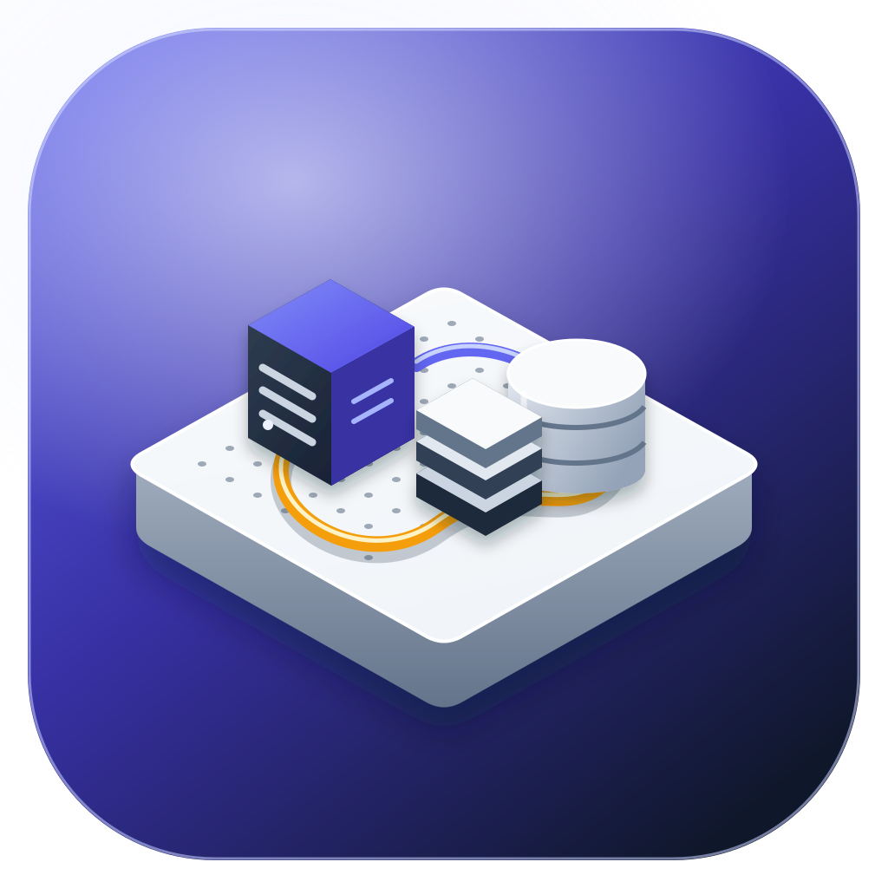
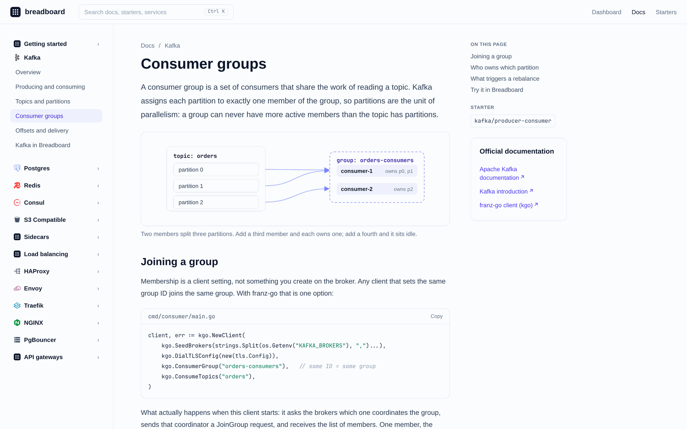
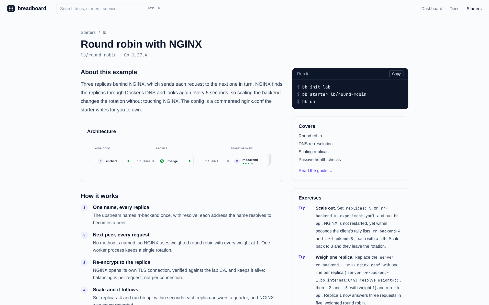
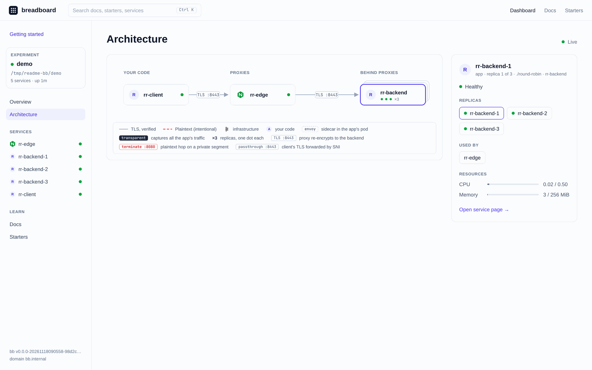
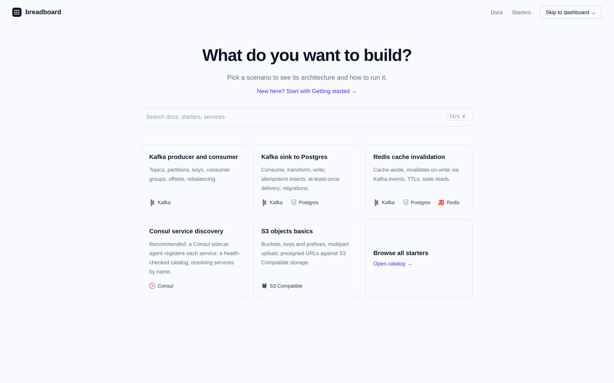

<p align="center">
  
</p>

<h1 align="center">Breadboard</h1>

<p align="center">
  <b>A local lab for learning system design with real services; run Kafka, Postgres, Redis, Consul, proxies and more in Docker with TLS on every connection.</b>
</p>

<p align="center">
  Pick a scenario, get real services and working Go code that uses each technology's official client library, then watch how it behaves from the CLI or a web dashboard.<br>
  <i>By Brian Nunez.</i>
</p>

<p align="center">
  
  
  
  <br>
  <a href="https://github.com/brian-nunez/breadboard/actions/workflows/ci.yml"></a>
  <a href="https://github.com/brian-nunez/breadboard/releases/latest"></a>
  <a href="https://www.linkedin.com/in/brianjnunez/"></a>
  
</p>

<p align="center">
  <a href="#install"></a>
</p>

<p align="center">
  <a href="#install"><b>Install</b></a> ·
  <a href="#quick-start">Quick start</a> ·
  <a href="#starters">Starters</a> ·
  <a href="#learning-guides">Learning guides</a> ·
  <a href="https://breadboard.b8z.me/">Docs site</a>
</p>

<br>

<p align="center">
  
  <br><sub><b>A running lab in <code>bb serve</code></b>: the lb/round-robin starter, with an NGINX proxy balancing three replicas over TLS.</sub>
</p>

> [!NOTE]
> **You need Docker with Docker Compose v2, on macOS or Linux.** Go is needed only to install with `go install`: Breadboard requires Go 1.27.4, and any `go` command from Go 1.21 on downloads that toolchain automatically.

<p align="center">
  <a href="#what-you-get">What you get</a> ·
  <a href="#install">Install</a> ·
  <a href="#quick-start">Quick start</a> ·
  <a href="#usage">Usage</a> ·
  <a href="#starters">Starters</a> ·
  <a href="#supported-services">Services</a> ·
  <a href="#license">License</a>
</p>

## What you get

- **Real services.** Every service is the real software in a Docker container, with a pinned image, a health check and memory and CPU limits. No mocks, no emulators.
- **TLS everywhere.** Every connection between containers uses TLS from a local certificate authority. Breadboard generates passwords and certificates and hands them to your code as environment variables; `bb creds` shows them.
- **Starters.** Working Go programs for one scenario each (consumer groups, cache invalidation, load balancing, API gateways), built with the official client libraries (`franz-go`, `pgx`, `go-redis`, the Consul API, `aws-sdk-go-v2`), each with exercises to try.
- **Learning guides and diagrams.** `bb serve` opens a web UI with a live dashboard, an architecture diagram of your lab, logs, and guides for every technology.
- **Your own program.** `bb add app <name>` writes a minimal Go app wired to the services in your lab.
- **Browser access.** Open an app or an HTTPS service from your browser at `https://<name>.<experiment>.localhost:<port>`.
- **AI agents.** `bb mcp` lets an agent build, run and inspect a lab for you.

## Install

Install with Go:

```sh
go install github.com/brian-nunez/breadboard/bb@latest
```

Or download a binary from the [Releases page](https://github.com/brian-nunez/breadboard/releases). Each release has `bb-linux-amd64`, `bb-linux-arm64`, `bb-darwin-amd64` and `bb-darwin-arm64`, plus `SHA256SUMS`. For example, on Linux on x86-64:

```sh
asset=bb-linux-amd64                                    # or bb-linux-arm64, bb-darwin-amd64, bb-darwin-arm64
curl -LO https://github.com/brian-nunez/breadboard/releases/latest/download/$asset
curl -LO https://github.com/brian-nunez/breadboard/releases/latest/download/SHA256SUMS
grep " $asset\$" SHA256SUMS | shasum -a 256 -c          # prints "<asset>: OK"
chmod +x $asset
sudo mv $asset /usr/local/bin/bb
```

On macOS, a binary downloaded with a web browser is quarantined by Gatekeeper (one downloaded with `curl` is not); clear the flag before the first run:

```sh
xattr -d com.apple.quarantine /usr/local/bin/bb
```

Check the install:

```sh
bb version
```

## Quick start

Start a Kafka lab with a producer and a consumer:

```sh
mkdir lab && cd lab
bb init                                # create experiment.yaml and .bb/ for generated secrets
bb starter kafka/producer-consumer     # write the Go code, add Kafka and two apps
bb up                                  # build, start everything and wait for health
bb serve                               # open the web UI: dashboard, architecture, logs, guides
bb logs consumer -f                    # follow the consumer's logs
bb down                                # stop the lab and delete its data volumes
```

- `experiment.yaml` describes the lab. It holds no secrets, so you can commit it.
- `bb serve` prints a sign-in link and opens it in your browser; it serves on `127.0.0.1:7777` by default (`--addr` changes it, `--no-open` skips the browser).
- `bb down --keep-volumes` keeps the data volumes for the next `bb up`.
- Each starter writes a README next to its code with exercises to try and things to break.

## Screenshots

<table>
<tr>
<td width="50%" valign="top"><br><sub><b>Learning guide</b>: Kafka consumer groups, with a diagram and the Go code.</sub></td>
<td width="50%" valign="top"><br><sub><b>Starter page</b>: lb/round-robin, with its architecture, commands and exercises.</sub></td>
</tr>
<tr>
<td width="50%" valign="top"><br><sub><b>Architecture</b>: your code, proxies and replicas, with every TLS edge.</sub></td>
<td width="50%" valign="top"><br><sub><b>Landing page</b>: suggested starters and search across docs and services.</sub></td>
</tr>
</table>

## Usage

| Command | What it does |
| ------- | ------------ |
| `bb init [name]` | Create `experiment.yaml` and `.bb/` here; create the install home and its CA if missing. |
| `bb catalog` | List the infra service types. |
| `bb add <type> [--name n] [--config k=v]` | Add an infra service to `experiment.yaml`, with optional `config` options. |
| `bb add app <name> [--uses a,b] [--dir path]` | Write your own Go app and add it to `experiment.yaml`. |
| `bb remove <name>` | Remove a service or app from `experiment.yaml`. |
| `bb starters` | List the starters. |
| `bb starter <id> [--dir path]` | Write a starter's code and add its services and apps. |
| `bb up [--timeout d]` | Start the lab and wait for every service to be healthy. |
| `bb down [--keep-volumes]` | Stop the lab and delete its data volumes; `--keep-volumes` keeps them. |
| `bb status` | Show each service's state, health, CPU and memory. |
| `bb logs [service] [-f] [--tail n]` | Show or follow logs. |
| `bb creds [service]` | Show generated credentials and connection strings. |
| `bb learn <type>` | Show a service type's learning notes. |
| `bb ca [--host] [--pem]` | Show the Breadboard CAs and how to trust them. |
| `bb config [get <key> \| set <key> <value>]` | Show or change install settings. |
| `bb migrate` | Upgrade `experiment.yaml` to the current spec version. |
| `bb export compose [--out dir] [--secrets inline\|dotenv]` | Write a standalone Docker Compose stack. |
| `bb serve [--addr host:port] [--no-open]` | Open the read-only web UI for this lab. |
| `bb mcp [--read-only]` | Serve `bb` as MCP tools over stdio, for AI agents. |
| `bb version` | Show the `bb` version. |
| `bb help [command]` | Show help, or a command's arguments. |

`bb -C <dir> <command>` runs a command against the lab in another directory.

## Write your own program

When you want to build your own design instead of following a starter, add an app:

```sh
bb add kafka            # add the services you need
bb add app orders       # write ./orders and add it to experiment.yaml
bb up                   # build, connect every client and verify health
bb logs orders          # confirm the app connected
```

`bb add app` writes a Go module (`main.go`, `go.mod`, `go.sum`, `Dockerfile`, `README.md`) into a new directory. By default the app uses every infra service in the lab; `--uses a,b` picks some. `main.go` contains:

- a header listing every service the app uses, with each environment variable it receives and an example value;
- `main()` at the top: `requireEnv` checking those variables, auto-wired official SDK clients (such as `newPostgres`, `newRedis`, `newKafkaProducer`/`newKafkaConsumer`, `newS3`, `newConsul`, `newHTTPClient`) that connect and verify connectivity on startup, and `<-ctx.Done()` so `bb up` starts healthy;
- the small `new*` wiring functions below `main()`.

There is no fake business logic connecting the services—just live SDK handles ready for your experiment. Write your code in `main.go`, then run `bb up` again. `bb creds` shows every value the app receives.

## Starters

List them with `bb starters` and apply one with `bb starter <id>`. Each one adds the services it needs.

**Kafka, Postgres, Redis, S3 and Consul**

| Starter | What you see |
| ------- | ------------ |
| `kafka/producer-consumer` | Topics, partitions, keys, consumer groups, offsets and rebalancing. |
| `kafka/sink-to-postgres` | Consume, transform and write; idempotent inserts; at-least-once delivery; migrations. |
| `redis/cache-invalidation` | Cache-aside, invalidate-on-write through Kafka events, TTLs and stale reads. |
| `s3/objects-basics` | Buckets, keys and prefixes, multipart upload and presigned URLs. |
| `consul/service-discovery` | Recommended: a Consul sidecar agent registers each service; resolving services by name. |
| `consul/self-registration` | The alternative: each service registers and deregisters itself through the Consul API. |

**OpenTelemetry (LGTM)**

| Starter | What you see |
| ------- | ------------ |
| `otel/traces` | Multi-service W3C `traceparent` propagation over HTTPS (`otelhttp`), custom spans and errors in Tempo (`signals: traces`). |
| `otel/metrics` | Counters, UpDownCounters, explicit-bucket Histograms, `otelhttp` and Go runtime metrics across replicas in Prometheus (`signals: metrics`). |
| `otel/logs` | Multi-service `log/slog` structured logs bridged via `otelslog` to Loki (`signals: logs`). |
| `otel/multi-service` | Correlated logs, metrics and traces across four Go services, Postgres and Kafka (with trace propagation in Kafka headers) in full LGTM. |

**OpenSearch**

| Starter | What you see |
| ------- | ------------ |
| `opensearch/search-basics` | Explicit `text`/`keyword`/numeric mappings, bulk indexing of 40 Washington State DOL EV registrations, typo-tolerant BM25 queries, cached filters and faceted aggregations. |
| `opensearch/postgres-cdc-sync` | CQRS read-model projection (`postgres` → `kafka` → `opensearch`) on 40 Washington State EV registrations with manual Kafka offset commits and live lag checks. |
| `opensearch/zero-downtime-reindex` | Immutable mapping migration (`v1` → `v2`) via server-side `_reindex` and atomic `_aliases` swap while live queries run with zero errors. |

**Sidecars**

| Starter | What you see |
| ------- | ------------ |
| `sidecar/envoy-ambassador` | An Envoy sidecar balancing calls across three replicas, with retries and timeouts in config, not code. |
| `sidecar/envoy-tls-termination` | A plain HTTP app with no TLS code, served over verified TLS by its Envoy sidecar. |
| `sidecar/envoy-transparent` | Every connection sent through Envoy: plain calls leave as TLS, and egress deny refuses undeclared services. |
| `sidecar/circuit-breaking` | A flaky replica ejected by the caller's Envoy sidecar after consecutive 5xx, then let back in. |
| `sidecar/pgbouncer-pool` | 50 client connections sharing 10 Postgres connections through a PgBouncer sidecar. |
| `sidecar/log-shipper` | A Fluent Bit sidecar shipping an app's log files to S3 Compatible storage. |

**Load balancing**

| Starter | What you see |
| ------- | ------------ |
| `lb/round-robin` | NGINX rotating across three replicas found through DNS; scale the backend and it follows. |
| `lb/least-connections` | HAProxy `leastconn` vs `roundrobin` when one replica is ten times slower. |
| `lb/power-of-two-choices` | Traefik `p2c` vs `wrr`: the slow replica gets far fewer requests. |
| `lb/consistent-hashing` | Envoy `ring_hash` vs `maglev`: the same key lands on the same replica, and removing one remaps few keys. |
| `lb/sticky-sessions` | An HAProxy cookie pinning each user to a replica, and what happens when it stops. |
| `lb/weighted-canary` | A Traefik 90/10 canary, and shifting weights to roll v2 out or back. |
| `lb/blue-green` | Cutting every request over from blue to green with an NGINX reload, without failing one. |
| `lb/health-checks` | HAProxy active checks vs Envoy passive outlier detection: time to eject and to let back. |
| `lb/consul-traefik` | Backends registering in Consul, and Traefik discovering and balancing them with no proxy config to edit. |

**Proxies and pooling**

| Starter | What you see |
| ------- | ------------ |
| `proxy/l4-vs-l7` | HAProxy `mode http` routing by path or header next to `mode tcp`, which cannot see paths. |
| `proxy/tls-modes` | Re-encrypt, terminate and passthrough in one HAProxy, and which certificate the client sees. |
| `proxy/request-mirroring` | Envoy copying every request to v2 and discarding its answers. |
| `proxy/connection-draining` | Draining a replica through HAProxy and stopping it under load with no failed requests. |
| `pgbouncer/pooling-modes` | A shared PgBouncer in session and transaction mode, and the session-state traps of transaction mode. |

**API gateways**

| Starter | What you see |
| ------- | ------------ |
| `gw/path-host-routing` | One Traefik gateway routing by path prefix and Host header, with a default route. |
| `gw/request-transformation` | Traefik middlewares adding and removing headers, rewriting paths and redirecting retired URLs. |
| `gw/api-versioning` | v1 and v2 behind NGINX by path or header, with deprecation headers on v1. |
| `gw/rate-limiting` | The same bursts through an Envoy token bucket and an NGINX leaky bucket, with a bucket per client. |
| `gw/circuit-breaking` | Envoy circuit breakers turning overload into fast 503s in front of a slow backend. |
| `gw/retries-and-timeouts` | Envoy retries hiding a flaky backend, and a retry storm with and without a retry budget. |
| `gw/jwt-auth` | Envoy verifying JWTs at the edge: no token or a forged one gets 401. |
| `gw/forward-auth` | Traefik asking an auth service about every request and passing its identity on. |
| `gw/bff-aggregation` | A backend for frontend fanning one call out to two services, next to plain gateway routing. |
| `gw/grpc-routing` | Envoy routing gRPC by service name over HTTP/2, with a per-method deadline. |

### Learning guides

`bb serve` includes guides with diagrams and Go code for Kafka, Postgres, Redis, Consul, S3 Compatible, sidecars, load balancing, HAProxy, Envoy, Traefik, NGINX, PgBouncer and API gateways, each linked to the starters that show it. `bb learn <type>` prints a service's learning notes in the terminal.

## Supported services

`bb catalog` lists these; add one with `bb add <type>`.

| Type | What it is |
| ---- | ---------- |
| **`kafka`** | Apache Kafka: a single broker in KRaft mode, SSL on 9093. |
| **`postgres`** | PostgreSQL with TLS required (verify-full). |
| **`redis`** | Redis: TLS only on 6379, password auth. |
| **`consul`** | HashiCorp Consul service catalog and KV store: one server, HTTPS on 8501. |
| **`s3-compatible`** | Object storage speaking the S3 API (SeaweedFS): HTTPS on 8333, generated access keys. |
| **`otel`** | OpenTelemetry Collector + Grafana LGTM (Loki, Prometheus, Tempo): OTLP TLS on 4317/4318, Grafana HTTPS on 3000; selective `config.signals`. |
| **`opensearch`** | Distributed search and analytics engine (single-node OpenSearch 3.10): HTTPS on 9200, loopback transport, generated admin password, optional `config.indices`. |
| **`haproxy`** | HAProxy load balancer and reverse proxy: TLS on 8443. |
| **`envoy`** | Envoy proxy and load balancer: TLS on 8443, active health checks. |
| **`traefik`** | Traefik router and load balancer from a file provider: TLS on 8443. |
| **`nginx`** | NGINX reverse proxy: TLS on 8443, SNI passthrough with the stream module. |
| **`pgbouncer`** | PgBouncer connection pool shared by apps in front of one Postgres: TLS on 6432. |

The HTTP proxies (HAProxy, Envoy, Traefik, NGINX) support path routing and re-encrypt, terminate and SNI passthrough per upstream. Envoy, PgBouncer and Fluent Bit also run as sidecars next to an app.

## Open a service in your browser

Add `host` to an app or to an infra service with an HTTPS listener (a proxy, Consul, S3 Compatible) in `experiment.yaml`:

```yaml
services:
  edge:
    type: haproxy
    upstreams:
      - service: api
        port: 8443
    host: true
apps:
  api:
    path: ./api
    replicas: 3
    host:
      port: 8443          # the port the app serves TLS on
```

After `bb up`, each target answers at `https://<name>.<experiment>.localhost:<port>`, and each replica at `https://<app>-<n>.<experiment>.localhost:<port>`. The port is chosen once per lab, published on `127.0.0.1` only, and printed by `bb up` and `bb status`.

The certificate comes from a separate host CA that can sign only `*.localhost` names. Breadboard never changes your trust store; `bb ca` shows the commands to trust it on macOS, Linux and Firefox. Browsers and curl resolve `*.localhost` to `127.0.0.1`; other clients may need an `/etc/hosts` entry for each name.

## Use it from an AI agent

`bb mcp` serves Breadboard as MCP tools over stdio, so an agent can create a lab, apply starters, run it, and read logs, credentials and live data (Kafka topics, Postgres tables, Redis keys, the Consul catalog, S3 buckets). Register it from the lab's directory:

```sh
claude mcp add breadboard -- bb mcp                # Claude Code
codex mcp add breadboard -- bb mcp                 # Codex CLI
```

Other clients take the same command in their config: `{"command": "bb", "args": ["mcp"]}`. Tools act only on directories inside the one `bb mcp` starts in (choose it with `bb -C <dir> mcp`), and `bb mcp --read-only` exposes only the tools that change nothing you own. The agent should call the `guide` tool first.

## Development

```sh
make build               # build bin/bb
make check               # what CI runs on every pull request
make test-integration    # Docker-backed integration tests (CI runs them on main)
```

`make check` runs formatting, vet, lint, the unit and script tests, and checks that generated web files and `go.mod` are up to date; it needs `golangci-lint`. The integration tests need Docker.

## License

Breadboard is licensed under the [MIT License](LICENSE). Copyright (c) 2026 Brian Nunez.
