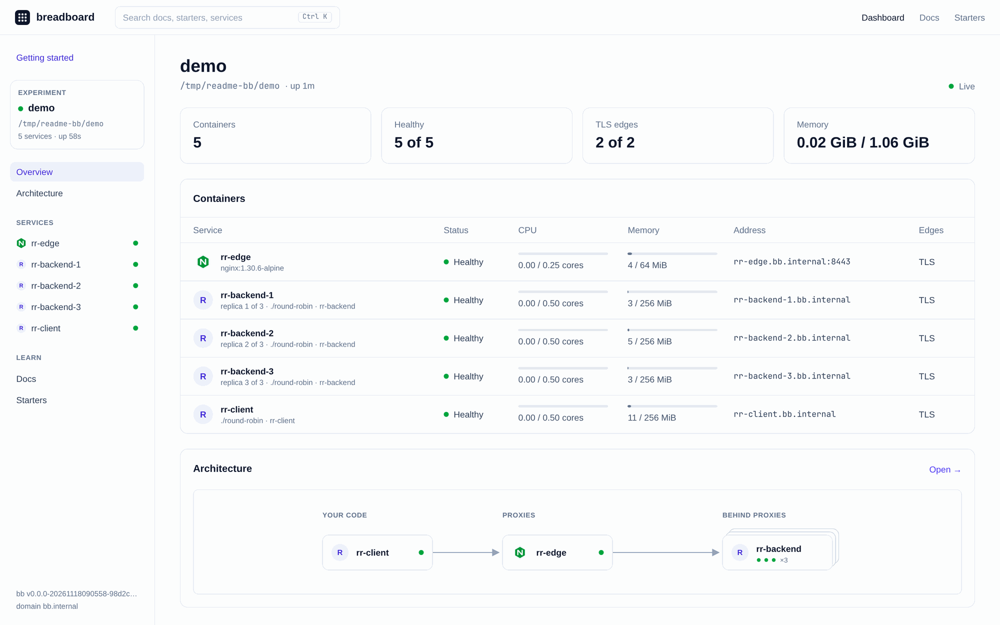

<p align="center">
  
</p>

<h1 align="center">Breadboard</h1>

<p align="center">
  <b>A local lab for real system design; wire up Kafka, Postgres, Redis and Consul in Docker with TLS by default, built in Go.</b>
</p>

<p align="center">
  Pick a scenario, get real services and working starter code, then see how they behave. Everything runs on your machine, and an experiment can be exported to Compose, Kubernetes, Terraform and Ansible.<br>
  <i>By Brian Nunez.</i>
</p>

<p align="center">
  
  
  
  
  <br>
  <a href="https://www.linkedin.com/in/brianjnunez/"></a>
  
</p>

<p align="center">
  <a href="docs/design/README.md"><b>Design docs</b></a> ·
  <a href="docs/adr/README.md">Decisions</a> ·
  <a href="docs/design/roadmap.md">Roadmap</a> ·
  <a href="docs/design/ui/README.md">UI design</a>
</p>

<br>

<p align="center">
  
  <br><sub><b>Design preview</b>: the <code>bb serve</code> dashboard. This is a design mockup, not a screenshot of running software.</sub>
</p>

> [!IMPORTANT]
> **Breadboard is early.** Phases 1 to 4 work: the core engine and CLI, five services including S3 Compatible, Compose export, the read-only web UI (`bb serve`) and the MCP server (`bb mcp`). Phase 5 has begun: reverse proxies and load balancers as services (Envoy, Traefik, HAProxy, NGINX, PgBouncer) with re-encrypt, terminate and passthrough per upstream; sidecars (Envoy, PgBouncer, Fluent Bit) that share an app's network namespace, with transparent proxying and egress policy; and app replicas. Load-balancing and gateway examples, mTLS and other exporters are next. Requires Go 1.27.4 and Docker with Compose v2 on macOS or Linux.

<p align="center">
  <a href="#why-breadboard">Why Breadboard</a> ·
  <a href="#how-it-works">How it works</a> ·
  <a href="#supported-services">Supported services</a> ·
  <a href="#starters">Starters</a> ·
  <a href="#roadmap">Roadmap</a> ·
  <a href="#documentation">Documentation</a> ·
  <a href="#license">License</a>
</p>

## Why Breadboard

- **Real systems.** Every service is the real software in a container. No cloud emulators, no mocks.
- **Real libraries.** There is no Breadboard SDK. Starter code uses the client libraries the ecosystem uses (`franz-go`, `pgx`, `go-redis`, the Consul API, `aws-sdk-go-v2`), so what you learn carries over. See [ADR-0006](docs/adr/0006-use-official-client-libraries-instead-of-a-breadboard-sdk.md).
- **Secure by default.** Every connection between containers uses TLS from a local, name-constrained CA. Plaintext is an explicit choice with a written reason, isolated on a private network. See [security](docs/design/security.md).
- **No credential handling.** Breadboard generates passwords and certificates, injects them as environment variables, and shows them when you ask.
- **Limits you can see.** Every container, including your own code, runs with memory and CPU limits and a health check, so resource pressure shows up the way it would in production.
- **No lock-in.** `experiment.yaml` is a plain file you commit, and exports run without `bb` installed.

## How it works

An experiment is a directory with an `experiment.yaml`. Breadboard resolves it against its catalog of services, generates certificates and secrets, writes a Compose project, and runs it on its own Docker network. Your app code runs as containers on that same network, addressed as `<service>.bb.internal`.

The workflow:

```sh
go install github.com/brian-nunez/breadboard/bb@latest   # one binary on your machine
mkdir kafka-lab && cd kafka-lab
bb init kafka-lab                                        # create experiment.yaml and .bb/
bb add kafka                                             # add a real Kafka broker
bb starter kafka/producer-consumer                       # write a Go producer and consumer
bb up                                                    # start everything and wait for health
bb logs consumer -f                                      # watch messages arrive over TLS
bb serve                                                 # open the read-only dashboard and docs
```

`bb` itself runs on your machine; only experiments run in containers. The CLI, the read-only web UI (`bb serve`) and the MCP server (`bb mcp`) are thin wrappers over one core engine. See [architecture](docs/design/architecture.md).

## Use it from an AI agent

`bb mcp` serves Breadboard as MCP tools over stdio, so an agent can create an experiment, apply starters, run it, read logs, credentials and live data (Kafka topics, Postgres tables, Redis keys, the Consul catalog, S3 buckets), and debug it. Register it with your client from the experiment's directory:

```sh
claude mcp add breadboard -- bb mcp                # Claude Code
codex mcp add breadboard -- bb mcp                 # Codex CLI
```

Other clients take the same command in their config: `{"command": "bb", "args": ["mcp"]}`. Tools act only on directories inside the one `bb mcp` starts in (choose it with `bb -C <dir> mcp`), and `bb mcp --read-only` exposes only the tools that change nothing you own. The agent should call the `guide` tool first.

## Supported services

| Service | Implementation | Phase |
| ------- | -------------- | ----- |
| **Kafka** | Official `apache/kafka` image, single node in KRaft mode | 1 |
| **Postgres** | Official `postgres` image | 1 |
| **Redis** | Official `redis` image | 1 |
| **Consul** | Official `hashicorp/consul` image | 1 |
| **S3 Compatible** | SeaweedFS | 2 |
| **Envoy** | Official `envoyproxy/envoy` image, as a proxy service or a sidecar | 5 |
| **Traefik** | Official `traefik` image, file provider only | 5 |
| **HAProxy** | Official `haproxy` image | 5 |
| **NGINX** | Official `nginx` image (Alpine) | 5 |
| **PgBouncer** | `edoburu/pgbouncer`, as a shared pool or a sidecar | 5 |

Each catalog entry pins an exact image version, configures TLS, sets resource limits and a health check, and ships learning notes. See the [catalog](docs/design/catalog.md).

## Starters

| Starter | Teaches | Phase |
| ------- | ------- | ----- |
| **kafka/producer-consumer** | Topics, partitions, keys, consumer groups, offsets, rebalancing. | 1 |
| **kafka/sink-to-postgres** | Consume, transform and write; idempotent inserts; at-least-once delivery. | 2 |
| **redis/cache-invalidation** | Cache-aside reads with invalidate-on-write driven by Kafka events. | 2 |
| **consul/service-discovery** (recommended) | Registration through a Consul sidecar and resolving services by name. | 2 |
| **consul/self-registration** (alternative) | The same lookup, with each service registering and deregistering itself. | 2 |
| **s3/objects-basics** | Buckets, prefixes, multipart uploads and presigned URLs. | 2 |
| **sidecar/envoy-ambassador** | The ambassador pattern: client-side load balancing, retries and timeouts in an Envoy sidecar. | 5 |
| **sidecar/envoy-tls-termination** | TLS termination at a sidecar in front of a plaintext app. | 5 |
| **sidecar/envoy-transparent** | Transparent proxying of all app traffic and egress deny, the root of service ACLs. | 5 |
| **sidecar/circuit-breaking** | Envoy outlier detection ejecting a flaky replica and letting it back in. | 5 |
| **sidecar/pgbouncer-pool** | Fifty clients sharing ten Postgres connections through a PgBouncer sidecar. | 5 |
| **sidecar/log-shipper** | The adapter pattern: a Fluent Bit sidecar shipping app log files to S3 Compatible storage. | 5 |

Starters are Go 1.27.4 projects with a multi-stage Dockerfile and a README with exercises to try and things to break. See [starters](docs/design/starters.md).

## Roadmap

1. Core engine and CLI, four services, the first starter, Compose export.
2. More starters and the S3 Compatible entry.
3. Read-only web UI.
4. MCP server.
5. Proxies and relays.
6. mTLS and multiple CAs.
7. Exporters: Kubernetes, Ansible, Terraform for AWS, GCP and Cloudflare.
8. More languages and services.

Completion criteria for each phase are in the [roadmap](docs/design/roadmap.md).

## Documentation

- [Design overview](docs/design/README.md): principles, glossary and a map of the design docs
- [Architecture](docs/design/architecture.md): core API, state files, CLI surface and repository layout
- [Experiment spec](docs/design/spec.md): the `experiment.yaml` format
- [Security](docs/design/security.md): CA, TLS policy and secrets
- [Exporters](docs/design/exporters.md): Compose, Kubernetes, Terraform and Ansible output
- [UI design](docs/design/ui/README.md): the accepted web UI frames
- [Architecture decision records](docs/adr/README.md)

## License

Breadboard is licensed under the [MIT License](LICENSE). Copyright (c) 2026 Brian Nunez.
